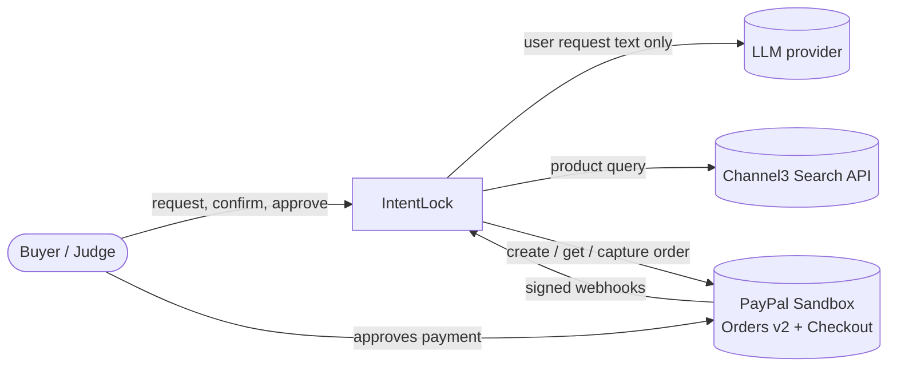
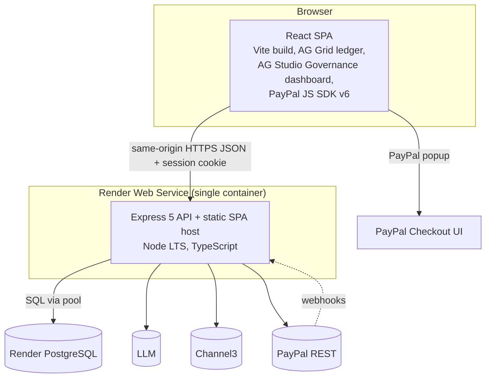
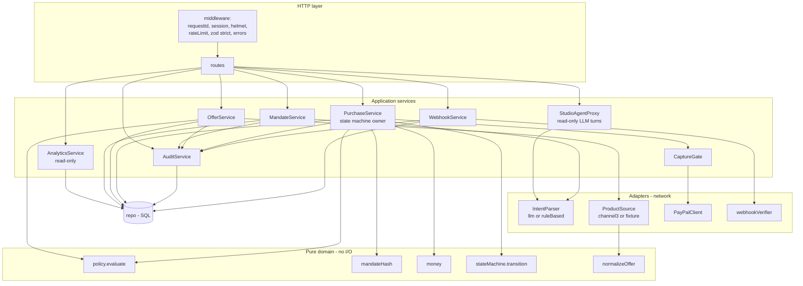
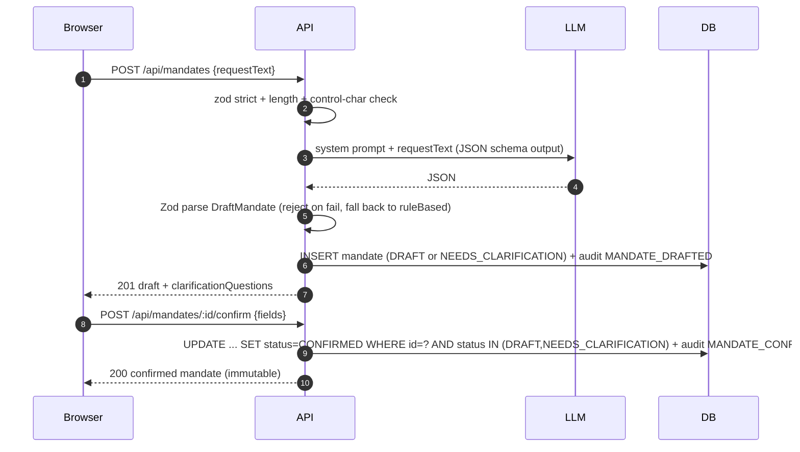
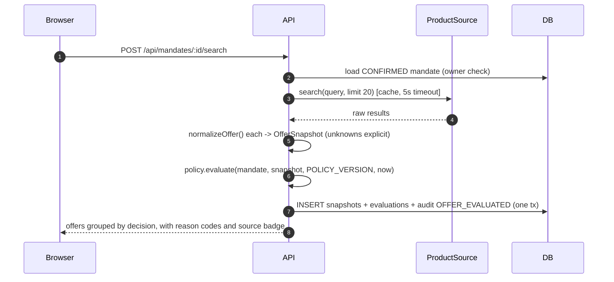
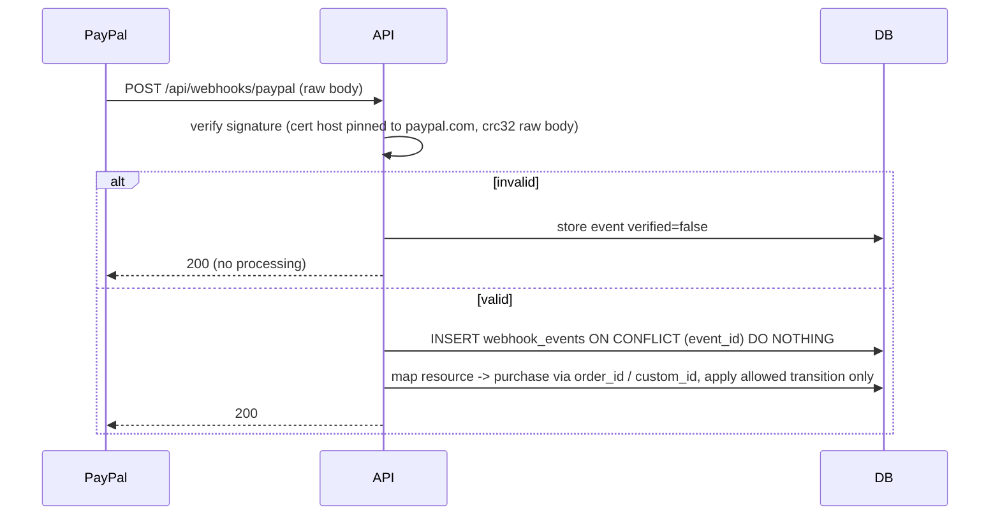
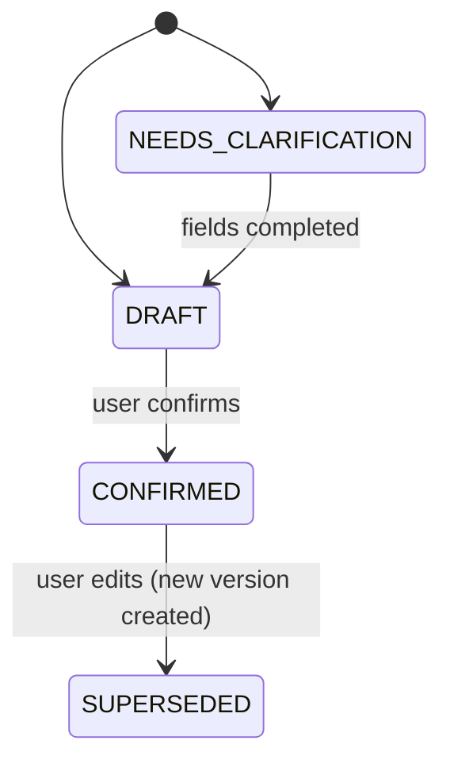
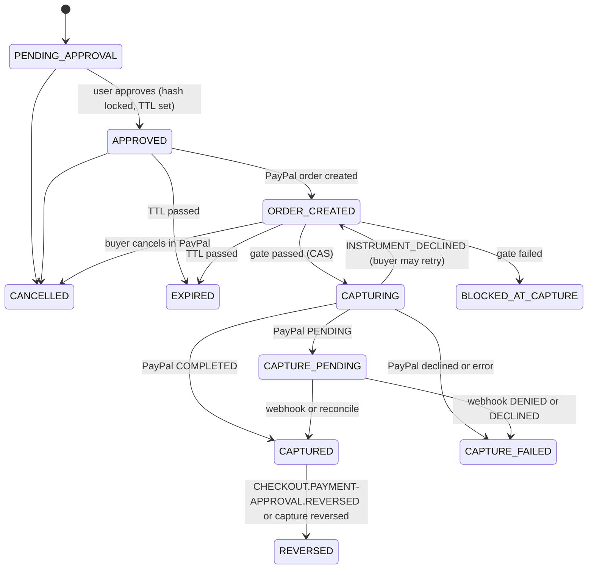
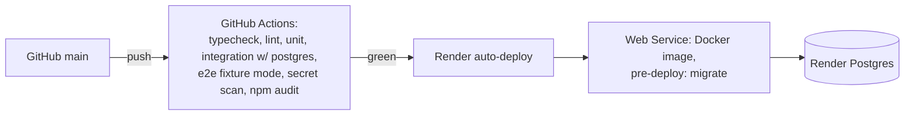
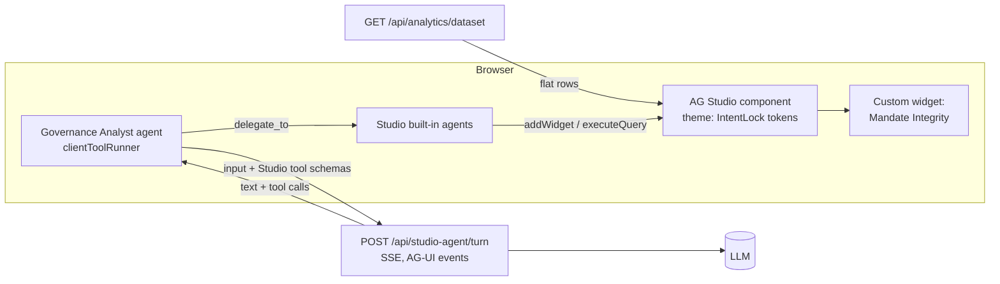

# IntentLock — Architecture

> **How** IntentLock is built. Requirements: [spec.md](spec.md). Evidence behind choices: [research.md](research.md). Schemas: [data-model.md](data-model.md). Routes: [contracts/api.md](contracts/api.md).

## 1. Architecture drivers

Ranked; when two conflict, the higher one wins.

| # | Driver | Architectural answer |
|---|---|---|
| 1 | **Payment integrity** — no capture outside the confirmed mandate | Pure policy engine + mandate hash + pre-capture gate against PayPal's own order record + DB compare-and-set state machine |
| 2 | **Auditability** | Append-only, hash-chained `audit_events`; every decision persisted with `policyVersion` and input snapshot |
| 3 | **Ship by 11 Nov with a small team** | Modular monolith, one deployable, one database, one LLM call per request |
| 4 | **Reproducibility for judges** | `docker compose up`, fixture mode, seeded demo scenario, Render blueprint |
| 5 | **Honest demo** | Source badges, sandbox labels, success only from verified PayPal status |

## 2. System context (C4 level 1)



Trust boundary: **everything outside `IntentLock` is untrusted input**, including the LLM and PayPal webhooks (until signature-verified).

## 3. Containers (C4 level 2)



**Why a single container:** same origin removes CORS and cross-site cookies, gives one CSP, one deploy, one log stream. The SPA is static files served by Express with long-cache hashed assets.

## 4. Backend components (C4 level 3)

Modular monolith. Each module exposes a narrow service interface; only `routes/` touches HTTP; only `adapters/` touch the network; only `repo/` touches SQL.



| Module | Responsibility | Must never |
|---|---|---|
| `core/policy` | `evaluate(mandate, offer, policyVersion) → Evaluation`. Pure, total, deterministic. | Do I/O, read clock (time is passed in), call LLM |
| `core/mandateHash` | Canonical JSON (sorted keys, minor units, lowercase domains) → SHA-256 hex | Include volatile fields (timestamps, IDs other than offerId) |
| `core/stateMachine` | Allowed transitions table; returns next state or throws `IllegalTransition` | Persist anything |
| `core/money` | Parse decimal string → `bigint` minor units; format; multiply by integer qty | Use `number` for amounts |
| `adapters/intentParser` | Return `DraftMandate` validated by shared Zod schema | Receive product data |
| `adapters/productSource` | Search with 5 s timeout, ≤ 20 results, 10-min LRU cache keyed by normalized query | Leak API key to client or logs |
| `adapters/paypal` | OAuth token cache, create/get/capture with `PayPal-Request-Id`, 15 s timeout, capture `paypal-debug-id` | Retry capture with a *new* request ID |
| `services/CaptureGate` | Implements the 7 checks in §6.3 | Be bypassable by any route |
| `services/AuditService` | Append event inside the caller's DB transaction; compute hash chain | Update or delete events |
| `services/AnalyticsService` | Flat, session-scoped dataset for AG Studio (one row per evaluation/purchase) | Write anything |
| `services/StudioAgentProxy` | Forward one AG Studio agent turn to the LLM with Studio's tool schemas; stream AG-UI events back | Expose any payment/state-changing tool; send data from other sessions |

## 5. Repository layout

npm workspaces monorepo. Shared code is **schemas and types only**; the policy engine stays server-side so the browser never becomes an authority.

```text
intentlock/
├─ apps/
│  ├─ web/                      # React + Vite SPA
│  │  └─ src/
│  │     ├─ features/{request,mandate,offers,approval,checkout,ledger,receipt,studio}/
│  │     ├─ api/client.ts       # typed fetch wrapper (shared types)
│  │     └─ main.tsx
│  └─ api/                      # Express 5 server
│     ├─ src/
│     │  ├─ core/               # pure: policy, mandateHash, money, stateMachine, normalizeOffer
│     │  ├─ adapters/           # intentParser/, productSource/, paypal/, webhookVerifier.ts
│     │  ├─ services/           # Mandate, Offer, Purchase, CaptureGate, Audit, Webhook
│     │  ├─ repo/               # SQL (Drizzle) + migrations/
│     │  ├─ routes/             # one file per resource
│     │  ├─ middleware/
│     │  ├─ config.ts           # zod-validated env, fails fast on boot
│     │  └─ server.ts
│     └─ test/{unit,integration,fixtures}/
├─ packages/
│  └─ shared/src/{schemas,types,reasonCodes}.ts
├─ e2e/                         # Playwright
├─ spec/                        # this folder
├─ docs/openapi.yaml            # generated from zod (zod-to-openapi)
├─ postman/intentlock.postman_collection.json
├─ docker-compose.yml           # postgres + api (dev)
├─ Dockerfile                   # multi-stage, non-root
├─ render.yaml                  # Render blueprint: web service + postgres
├─ .github/{copilot-instructions.md,workflows/ci.yml,prompts/}
├─ .env.example
└─ LICENSE (MIT)
```

## 6. Key runtime flows

### 6.1 Request → draft mandate → confirm



### 6.2 Search → normalize → evaluate



### 6.3 Approve → PayPal order → buyer approval → **capture gate**

```mermaid
sequenceDiagram
  autonumber
  participant B as Browser
  participant A as API
  participant D as DB
  participant P as PayPal
  B->>A: POST /api/purchases {mandateId, offerId}
  A->>A: re-evaluate; must be ALLOWED; total = unit x qty (bigint)
  A->>D: INSERT purchase PENDING_APPROVAL, mandateHash
  A-->>B: server-computed summary
  B->>A: POST /api/purchases/:id/approve {mandateHash}
  A->>D: CAS PENDING_APPROVAL->APPROVED, approvalExpiresAt=now+15m
  Note over B: JS SDK v6 session.start(createOrder)
  B->>A: POST /api/purchases/:id/paypal-order
  A->>D: get-or-create payment_operation(CREATE, requestId)
  A->>P: POST /v2/checkout/orders (PayPal-Request-Id, custom_id, invoice_id, amount)
  P-->>A: {id, status CREATED}
  A->>D: CAS APPROVED->ORDER_CREATED, paypal_order_id
  A-->>B: {paypalOrderId}
  B->>P: buyer logs in and approves
  Note over B: JS SDK v6 onApprove({orderId})
  B->>A: POST /api/purchases/:id/capture {paypalOrderId}
  rect rgb(255,245,230)
  Note over A: CaptureGate
  A->>D: load purchase, mandate, snapshot
  A->>P: GET /v2/checkout/orders/{id}
  A->>A: G1 order id matches purchase<br/>G2 PayPal status == APPROVED<br/>G3 amount + currency == stored total<br/>G4 custom_id == purchaseId<br/>G5 recomputed mandateHash == approved hash<br/>G6 policy.evaluate still ALLOWED<br/>G7 now < approvalExpiresAt
  end
  alt any check fails
    A->>D: CAS ORDER_CREATED->BLOCKED_AT_CAPTURE + audit CAPTURE_BLOCKED(reasons)
    A-->>B: 409 with reason codes
  else all pass
    A->>D: CAS ORDER_CREATED->CAPTURING (wins only once)
    A->>P: POST /v2/checkout/orders/{id}/capture (stable PayPal-Request-Id)
    P-->>A: capture {id, status}
    A->>D: CAPTURING->CAPTURED or CAPTURE_PENDING or CAPTURE_FAILED + audit
    A-->>B: verified status
  end
```

**Why `GET order` before capture:** it makes PayPal's record — not our cache and not the browser — the comparison target. If anything changed the order between approval and capture, G3/G4 catch it.

### 6.4 Webhook reconciliation (P1)



Returning 200 for invalid signatures avoids 3 days of PayPal retries for garbage; the event is still stored for inspection.

## 7. State machines

### 7.1 Mandate



### 7.2 Purchase



Every transition is executed as:

```sql
UPDATE purchases
   SET state = $next, version = version + 1, updated_at = now()
 WHERE id = $id AND state = $expected AND version = $expectedVersion
RETURNING *;
```

Zero rows ⇒ `409 STATE_CONFLICT`. This single statement is the concurrency control; no distributed locks needed.

**Crash recovery:** a purchase stuck in `CAPTURING` > 60 s is reconciled on read by `GET order` (PayPal is source of truth) — same `PayPal-Request-Id` is reused if a capture retry is required.

## 8. Policy engine design

```ts
// packages/shared — types only; implementation in apps/api/src/core/policy.ts
type Decision = "ALLOWED" | "BLOCKED" | "NEEDS_REVIEW";
type Severity = "BLOCKING" | "REVIEW" | "INFO";
interface Finding { code: ReasonCode; severity: Severity; message: string; evidence: Record<string, string | number | boolean> }
interface Evaluation { decision: Decision; findings: Finding[]; policyVersion: string; evaluatedAt: string }

function evaluate(m: ConfirmedMandate, o: OfferSnapshot, policyVersion: string, now: Date): Evaluation
```

- **Rule pipeline:** an ordered array of small pure rules `(m, o) => Finding[]`. All rules always run (no short-circuit) so the receipt shows every violation.
- **Decision fold:** any `BLOCKING` ⇒ `BLOCKED`; else any `REVIEW` ⇒ `NEEDS_REVIEW`; else `ALLOWED`.
- **Unknown handling:** each rule that needs a field emits `REVIEW` with a `*_UNKNOWN` code when the field is absent — never assumes a safe value.
- **Versioning:** `POLICY_VERSION` constant (semver) persisted with each evaluation. Changing rule semantics bumps it; old receipts stay explainable.
- **Explanations:** `message` is rendered from a template per reason code with evidence values interpolated as text. No LLM.

Rules (codes defined in [contracts/api.md §5](contracts/api.md#5-policy-reason-codes)): budget, currency, merchant allow-list, recurrence, excluded terms, quantity bounds, price/merchant presence.

## 9. Mandate hash

Protected fields (any change invalidates approval):

```json
{ "v": 1, "mandateId": "…", "mandateVersion": 1, "offerId": "…", "merchantDomain": "acme-office.example",
  "quantity": 2, "unitAmountMinor": "14900", "totalMinor": "29800", "currency": "USD",
  "recurrenceSignal": "NONE", "policyVersion": "1.0.0" }
```

- Canonicalization: keys sorted, no whitespace, amounts as decimal strings of minor units, domains lowercase. Implement with a 20-line deterministic serializer (no dependency) and a golden-file test.
- Hash: `sha256` via Node `crypto`. Not a secret and not a signature — it is an **equality fingerprint** stored at approval and recomputed at capture.

## 10. Idempotency and duplicate protection (defense in depth)

| Layer | Mechanism | Protects against |
|---|---|---|
| UI | Disable button while request in flight | Double-click |
| API state | CAS transition `ORDER_CREATED → CAPTURING` | Concurrent capture calls |
| PayPal create | Stable `PayPal-Request-Id` per purchase + `invoice_id = purchaseId` | Duplicate order creation on retry |
| PayPal capture | Stable `PayPal-Request-Id` stored in `payment_operations` | Timeout-then-retry double capture |
| DB | `UNIQUE(paypal_order_id)`, `UNIQUE(paypal_capture_id)`, `UNIQUE(webhook event_id)` | Any path that slips through |

## 11. Error model

All errors: `{"error": {"code": "STABLE_CODE", "message": "safe text", "requestId": "…", "details"?: [...]}}`. Mapping: validation `400`, no session `401`, other owner's resource `404` (do not reveal existence), illegal transition `409`, policy/gate rejection `409` with reason codes, upstream failure `502`, upstream timeout `504`, rate limit `429`. Stack traces never leave the server.

## 12. Configuration

Validated by Zod at boot; the process exits if invalid. Full list in `.env.example`:

| Variable | Notes |
|---|---|
| `NODE_ENV`, `PORT` | Render sets `PORT` |
| `DATABASE_URL` | Postgres; TLS required when not localhost |
| `SESSION_SECRET` | ≥ 32 random bytes; signs session cookie |
| `PAYPAL_CLIENT_ID`, `PAYPAL_CLIENT_SECRET`, `PAYPAL_ENV=sandbox` | Boot fails if `PAYPAL_ENV` ≠ `sandbox` (hackathon guard) |
| `PAYPAL_WEBHOOK_ID` | P1 |
| `AI_PROVIDER=openai\|rule`, `AI_API_KEY`, `AI_MODEL` | `rule` needs no key (offline/demo fallback) |
| `PRODUCT_SOURCE=channel3\|fixture`, `CHANNEL3_API_KEY` | |
| `APPROVAL_TTL_SECONDS=900`, `POLICY_VERSION` | |
| `AG_STUDIO_LICENSE_KEY` | Trial key; injected at runtime via `/api/config`, not committed. If missing, AG Studio shows its trial watermark. |
| `STUDIO_AGENT_ENABLED=true\|false` | Lets us switch the agent off if cost or abuse becomes a problem during judging |

`PAYPAL_CLIENT_ID` is the only value also exposed to the browser (it is public by design); it is served via `GET /api/config`, not baked into the bundle.

## 13. Deployment



- Multi-stage `Dockerfile`: build SPA + API → slim runtime, `USER node`, `NODE_ENV=production`.
- Migrations run as Render pre-deploy command, never at request time.
- Health check path `/api/health` (checks DB with `SELECT 1`, returns only `{status}`).
- Local: `docker compose up` starts Postgres + API (fixture product source, rule-based parser) — works with **no external keys** except PayPal sandbox.
- Plans: free web service + free Postgres during the build. **Before 30 Nov**, switch both to paid instances (hackathon Render credits). Free Postgres expires 30 days after creation, and a free web service sleeps after 15 min idle; neither is acceptable during judging (1–15 Dec).

## 14. Observability

- `pino` JSON logs; `requestId` from middleware; child loggers add `purchaseId`, `paypalOrderId`, `paypalDebugId`.
- Redaction paths: `authorization`, `*.client_secret`, `*.access_token`, `*.api_key`, `payer.email_address`, `payer.name`, cookies.
- Timings logged per adapter call (`ai_ms`, `search_ms`, `paypal_ms`) — this is the source for NFR-2 evidence.

## 15. Performance choices

| Choice | Effect |
|---|---|
| One LLM call per request, not per offer | Bounded latency and cost |
| Channel3 LRU cache (10 min, key = normalized query + limit) | Repeat demo searches are instant and quota-friendly |
| Batch insert snapshots + evaluations in one transaction | One round-trip per search |
| PayPal OAuth token cached until `expires_in − 60 s` | Removes a call per payment op |
| Indexes per [data-model.md §5](data-model.md#5-indexes) | Ledger queries stay index-only at demo scale |
| AG Grid Client-Side Row Model + `getRowId` | Stable row identity and cheap refresh |

## 16. Architecture decision records

| ADR | Decision | Status |
|---|---|---|
| ADR-001 | Modular monolith, single Render Web Service serving SPA + API | Accepted |
| ADR-002 | PostgreSQL with CAS state transitions; no external queue | Accepted |
| ADR-003 | LLM limited to drafting the mandate from the user's own text; never sees product data; never decides | Accepted |
| ADR-004 | Integer minor units (`bigint`) for all money; USD only in MVP | Accepted |
| ADR-005 | Mandate hash binding + `GET order` verification before capture | Accepted |
| ADR-006 | Recurrence derived by deterministic keyword signal (`subscription`, `membership`, `auto-renew`, `/mo`, `per month`, `plan`, `monthly`, `annual plan`); match ⇒ `RECURRING`, no match ⇒ `NONE` with evidence `method=keyword_v1`. Accepts both false positives (blocks safely) and false negatives; documented as a limitation. Chosen over "unknown ⇒ review" because Channel3 has no recurrence field and that rule would make every live offer unpurchasable. | Accepted |
| ADR-007 | Intent `CAPTURE` (not `AUTHORIZE`) | Accepted |
| ADR-008 | Anonymous signed-cookie session as tenancy key; no user accounts | Accepted |
| ADR-009 | Hash-chained append-only audit log with DB trigger blocking `UPDATE`/`DELETE` | Accepted |
| ADR-010 | AG Grid Community, Client-Side Row Model, for the operational ledger | Accepted |
| ADR-011 | Explanations templated from reason codes, not generated | Accepted |
| ADR-012 | PayPal **JS SDK v6** one-time payment session (`createOrder` returns `{orderId}`); v5 Buttons only as fallback | Accepted |
| ADR-013 | **AG Studio** Governance dashboard (custom widgets + theme + layout) on a read-only analytics dataset; needed for the AG Grid sponsor criteria | Accepted (P1, sponsor) |
| ADR-014 | AG Studio agent via `clientToolRunner`: the server runs the LLM turn (key stays server-side); only Studio dashboard tools in the browser; **no payment or state-changing tools exist** | Accepted (P1, sponsor) |

## 17. Governance Studio (AG Studio)

Purpose: answer the business owner's question *"Is my agent staying inside policy, and what is it costing me?"* using **only measured audit data**. No projected savings and no made-up KPIs.



**Dataset** (one row per evaluation, joined with its purchase if one exists): `time, day, productQuery, merchantDomain, source, decision, primaryReason, reasonCodes, offerTotalMinor, approved, purchaseState, capturedTotalMinor, blockedAtCapture, approvalToCaptureSeconds, policyVersion`.

**Default layout** (a saved Studio layout the user can change):

| Widget | Type | Metric (computed from data) |
|---|---|---|
| Decisions over time | Built-in chart | Count by `decision` per day |
| Why offers were blocked | Built-in chart | Count by `primaryReason` |
| Spend authorized vs captured | KPI tiles | Sum `capturedTotalMinor`; count of `CAPTURED`; count of `BLOCKED_AT_CAPTURE` |
| Approval-to-capture time | Built-in chart | Distribution of `approvalToCaptureSeconds` |
| **Mandate Integrity** | **Custom widget** | Result of `/api/audit/verify` (INTACT / BROKEN at seq N), events checked, capture-gate blocks by check G1–G7 |
| Decision ledger | Studio grid widget | Row-level drill-down |

**Agent guardrails:** the instructions limit the agent to analysing and visualising the provided dataset. The server forwards only Studio's dashboard tool schemas plus the session's own rows. It ignores any client-supplied tool not on an allow-list. Responses are rate-limited and capped at 8 turns. Product titles in the data are untrusted text; the worst a prompt injection can do is produce a misleading widget, because the agent has no write path.
