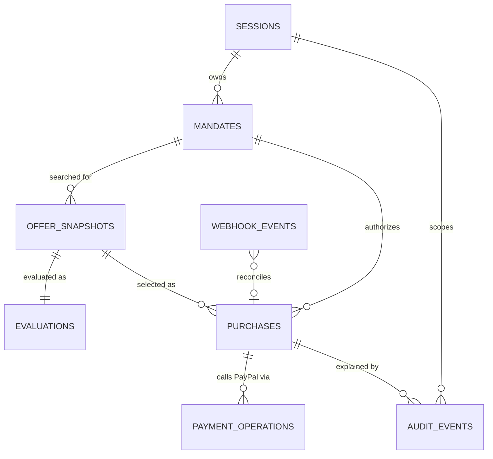

# IntentLock — Data Model

> PostgreSQL 16+. ORM: Drizzle (typed SQL + migrations). All timestamps `timestamptz` UTC. All IDs `uuid` (v7 preferred for index locality; v4 acceptable). Architecture context: [architecture.md](architecture.md).

## 1. Entity relationships



## 2. Tables

### `sessions`
| Column | Type | Notes |
|---|---|---|
| `id` | uuid PK | Value inside the signed cookie |
| `created_at`, `last_seen_at` | timestamptz | Expire after 7 days idle |

### `mandates`
| Column | Type | Notes |
|---|---|---|
| `id` | uuid PK | |
| `session_id` | uuid FK → sessions | Tenancy key; every query filters on it |
| `version` | int | 1-based; edits create a new row with `version+1` and `supersedes_id` |
| `supersedes_id` | uuid FK → mandates, null | |
| `status` | enum `DRAFT, NEEDS_CLARIFICATION, CONFIRMED, SUPERSEDED` | |
| `request_text` | text (≤ 1 000) | Original user text |
| `product_query` | text (≤ 200) | |
| `quantity` | int null | CHECK 1–100 when not null |
| `max_total_minor` | bigint null | CHECK > 0 |
| `currency` | char(3) | CHECK = `'USD'` (MVP) |
| `allowed_merchant_domains` | text[] | Normalized lowercase, no `www.`; CHECK cardinality 1–20 when CONFIRMED |
| `recurring_allowed` | boolean | Default `false` |
| `excluded_terms` | text[] | Lowercased; ≤ 20 |
| `clarification_questions` | jsonb | |
| `parser` | text | `llm:<model>` or `rule:v1` — provenance |
| `confirmed_at`, `created_at` | timestamptz | |

CHECK: `status <> 'CONFIRMED' OR (quantity IS NOT NULL AND max_total_minor IS NOT NULL AND cardinality(allowed_merchant_domains) >= 1)`.

### `offer_snapshots`
| Column | Type | Notes |
|---|---|---|
| `id` | uuid PK | |
| `mandate_id` | uuid FK | |
| `source` | enum `channel3, fixture` | Shown as UI badge |
| `source_product_id` | text | Provider ID |
| `title` | text (≤ 300) | Plain text; rendered as text only |
| `brand` | text null | |
| `merchant_name` | text null | |
| `merchant_domain` | text null | Normalized; null ⇒ `MERCHANT_UNKNOWN` |
| `offer_url` | text null | `https:` only, else null |
| `unit_amount_minor` | bigint null | null ⇒ `PRICE_UNKNOWN` |
| `currency` | char(3) null | |
| `recurrence_signal` | enum `NONE, RECURRING` | ADR-006 |
| `recurrence_evidence` | text null | Matched keyword |
| `raw_sha256` | char(64) | Hash of raw provider JSON (raw body not stored — minimizes data) |
| `observed_at` | timestamptz | |

### `evaluations`
| Column | Type | Notes |
|---|---|---|
| `id` | uuid PK | |
| `offer_snapshot_id` | uuid FK UNIQUE | One evaluation per snapshot |
| `decision` | enum `ALLOWED, BLOCKED, NEEDS_REVIEW` | |
| `findings` | jsonb | `Finding[]` |
| `policy_version` | text | |
| `evaluated_at` | timestamptz | |

### `purchases`
| Column | Type | Notes |
|---|---|---|
| `id` | uuid PK | Also sent to PayPal as `custom_id` and `invoice_id` |
| `session_id` | uuid FK | |
| `mandate_id`, `offer_snapshot_id` | uuid FK | |
| `quantity` | int | Copied from mandate |
| `unit_amount_minor`, `total_minor` | bigint | Server-computed; CHECK `total_minor = unit_amount_minor * quantity` |
| `currency` | char(3) | |
| `mandate_hash` | char(64) | Set at creation, verified at approve and capture |
| `state` | enum (see [architecture.md §7.2](architecture.md#72-purchase)) | |
| `version` | int | CAS counter |
| `approved_at`, `approval_expires_at` | timestamptz null | |
| `paypal_order_id` | text UNIQUE null | |
| `paypal_capture_id` | text UNIQUE null | |
| `paypal_status` | text null | Last status read **from PayPal** |
| `block_reasons` | jsonb null | Gate failures |
| `created_at`, `updated_at` | timestamptz | |

CHECK `state <> 'CAPTURED' OR paypal_capture_id IS NOT NULL`. Budget (`total_minor <= mandate.max_total_minor`) is cross-table, so it is enforced by the policy engine and re-checked in the capture gate, with tests.

### `payment_operations`
| Column | Type | Notes |
|---|---|---|
| `id` | uuid PK | |
| `purchase_id` | uuid FK | |
| `kind` | enum `CREATE_ORDER, CAPTURE` | |
| `paypal_request_id` | uuid UNIQUE | Reused on every retry of the same op |
| `status` | enum `STARTED, SUCCEEDED, FAILED` | |
| `http_status` | int null | |
| `paypal_debug_id` | text null | For PayPal support |
| `error_code` | text null | e.g. `INSTRUMENT_DECLINED` |
| `created_at`, `updated_at` | timestamptz | |

UNIQUE (`purchase_id`, `kind`) ⇒ at most one create and one capture op per purchase.

### `audit_events` (append-only)
| Column | Type | Notes |
|---|---|---|
| `seq` | bigserial PK | Global order |
| `id` | uuid UNIQUE | |
| `session_id` | uuid | |
| `mandate_id`, `purchase_id` | uuid null | |
| `type` | text | See §4 |
| `payload` | jsonb | Minimal evidence; no PII, no secrets |
| `prev_hash` | char(64) | Hash of previous event **in the same session** (genesis = 64 zeros) |
| `hash` | char(64) | `sha256(prev_hash ‖ canonical(type, payload, created_at, session_id, purchase_id))` |
| `created_at` | timestamptz | |

```sql
CREATE FUNCTION forbid_audit_mutation() RETURNS trigger LANGUAGE plpgsql AS
$$ BEGIN RAISE EXCEPTION 'audit_events is append-only'; END $$;
CREATE TRIGGER audit_no_update BEFORE UPDATE OR DELETE ON audit_events
  FOR EACH ROW EXECUTE FUNCTION forbid_audit_mutation();
```

Chain per session (not global) so concurrent sessions don't contend; within a session, append under `SELECT … FOR UPDATE` on the session row to serialize hash computation.

### `webhook_events`
| Column | Type | Notes |
|---|---|---|
| `event_id` | text PK | PayPal `id` — dedupe key |
| `event_type` | text | |
| `verified` | boolean | |
| `resource_order_id` | text null | |
| `purchase_id` | uuid null | Resolved match |
| `received_at`, `processed_at` | timestamptz | |

Raw body is not stored after verification (contains payer data); only IDs and type.

## 3. Money rules

- Parse provider strings with a strict regex `^\d{1,9}(\.\d{1,2})?$` → `bigint` minor units. Anything else ⇒ `PRICE_UNKNOWN`.
- `total = unit × quantity` in `bigint`. PayPal `amount.value` is formatted from minor units (`"298.00"`), never from a float.
- Comparison with PayPal at capture is done on **parsed minor units** of PayPal's `amount.value`, not string equality.
- Currency mismatch ⇒ `CURRENCY_UNSUPPORTED` (blocking).
- Lint guard: ESLint `no-restricted-syntax` forbids `parseFloat`/`Number(` in `core/money.ts` callers handling amounts.

## 4. Audit event types

| Type | Written when | Key payload fields |
|---|---|---|
| `MANDATE_DRAFTED` | Parser returns | parser, fields, clarificationQuestions |
| `MANDATE_CONFIRMED` | User confirms | mandate fields, version |
| `OFFER_EVALUATED` | Each offer evaluated | snapshotId, source, decision, reason codes, policyVersion |
| `PURCHASE_CREATED` | Purchase row inserted | totalMinor, mandateHash |
| `PURCHASE_APPROVED` | User approval | approvedAt, expiresAt |
| `REQUEST_REJECTED` | Strict schema / tamper attempt | route, unexpected field names (not values) |
| `PAYPAL_ORDER_CREATED` | Order created | paypalOrderId, paypalDebugId |
| `CAPTURE_BLOCKED` | Gate failed | failed checks + reason codes |
| `PAYPAL_CAPTURED` / `PAYPAL_CAPTURE_PENDING` / `PAYPAL_CAPTURE_FAILED` | Capture result | captureId, status, errorCode |
| `PURCHASE_CANCELLED` / `PURCHASE_EXPIRED` | Terminal | reason |
| `WEBHOOK_APPLIED` / `WEBHOOK_IGNORED` | Webhook processed | eventType, verified |

## 5. Indexes

| Index | Serves |
|---|---|
| `mandates (session_id, created_at DESC)` | Mandate list |
| `offer_snapshots (mandate_id)` | Search results |
| `purchases (session_id, created_at DESC)` | Ledger |
| `purchases (state) WHERE state IN ('CAPTURING','CAPTURE_PENDING')` | Reconciler |
| `audit_events (session_id, seq)` | Receipt + chain verify |
| `audit_events (purchase_id, seq)` | Receipt |

## 6. Retention and privacy

- No payer name/email/address stored. PayPal payer data stays in PayPal.
- Demo data older than 30 days may be purged by a documented SQL script run by the DB owner (temporarily disables the audit trigger inside one transaction). Purge removes whole sessions, so remaining chains stay internally consistent. Do not purge during the judging period (1–15 Dec 2026).
