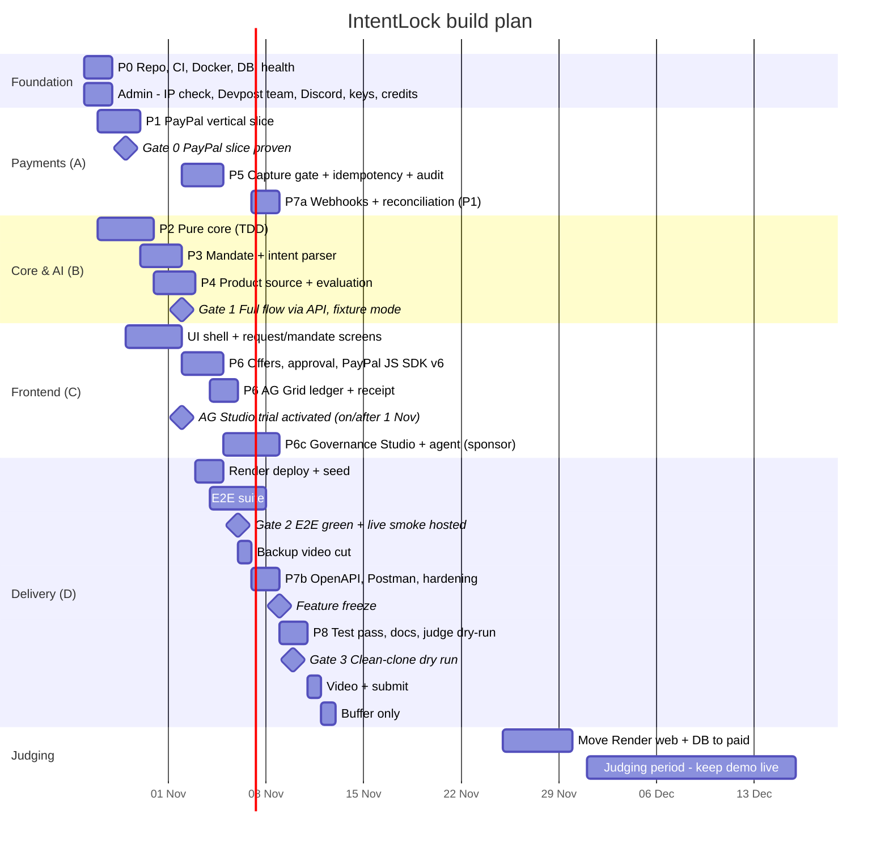

# IntentLock — Delivery Plan

> Calendar from **Mon 26 Oct 2026** to the deadline **Thu 12 Nov 2026 12:00 PT** (13 Nov 01:30 IST). Internal submission target **Wed 11 Nov**. Task-level detail: [tasks.md](tasks.md).

## 1. Strategy

1. **De-risk payment first.** PayPal Sandbox create → approve → capture is built on day 2–4, before AI or UI polish. It is the Stage-One pass/fail item.
2. **Pure core in parallel.** Policy, money, hash and state machine have no I/O, so one engineer builds them test-first while another fights PayPal integration.
3. **Fixture-first, live-second.** Every external dependency has a fixture/rule adapter, so the full flow runs offline by Gate 1 and Channel3/AI access problems never block the team.
4. **Thin vertical slices, merged daily** to `main` behind green CI.
5. **Freeze early.** No features after Mon 9 Nov; the last 2.5 days are for testing, docs and the video.

## 2. Roles (merge if the team is smaller)

| Role | Owns | Primary files |
|---|---|---|
| **A — Payments** | PayPal adapter, capture gate, idempotency, webhooks | `adapters/paypal`, `services/CaptureGate`, `services/Webhook` |
| **B — Core & AI** | Policy, money, hash, state machine, intent parser, Channel3 adapter | `core/*`, `adapters/intentParser`, `adapters/productSource` |
| **C — Frontend** | SPA flow, PayPal JS SDK v6, AG Grid ledger, AG Studio Governance dashboard, receipt, a11y | `apps/web/*` |
| **D — Quality & Delivery** | CI, Docker, Render, E2E, README, Postman, video | `.github/`, `e2e/`, `render.yaml`, `README.md` |

Rule: any change to `core/policy`, `CaptureGate` or state transitions needs review by a second person.

## 3. Schedule

| Dates | Phase | Exit criteria |
|---|---|---|
| Mon 26 – Tue 27 Oct | **P0 Foundation** | Clean clone → `npm ci && docker compose up` → `/api/health` 200 on two machines; CI green; MIT license; `.env.example`; Copilot instructions |
| Mon 26 – Tue 27 Oct | **Admin** | Employer/IP check done by every member; all members registered on Devpost and in one team; PayPal Discord joined; Channel3 key + promo applied; Render credits claimed; AI provider chosen with a spend cap ([submission.md](submission.md)) |
| Tue 27 – Thu 29 Oct | **P1 PayPal slice** | Fixed $1.00 test purchase: server create → sandbox buyer approves → server capture → stored `COMPLETED`; cancel path works |
| Tue 27 – Fri 30 Oct | **P2 Pure core** | UNIT-POL/HASH/MONEY/SM green; ≥ 95 % coverage on `core/` |
| Fri 30 Oct – Sun 1 Nov | **P3 Mandate** | `POST /mandates` with LLM + rule fallback; clarification; confirm/version |
| Sat 31 Oct – Mon 2 Nov | **P4 Discovery** | Channel3 live (or documented fixture fallback) + evaluation persisted |
| Mon 2 – Wed 4 Nov | **P5 Integrity** | Capture gate G1–G7; CAS transitions; `payment_operations`; hash-chained audit; INT-01..13 green |
| Mon 2 – Fri 6 Nov | **P6 UI** | Full UI flow; PayPal JS SDK v6; AG Grid ledger; receipt; a11y pass |
| Thu 5 – Sun 8 Nov | **P6c Governance Studio** | AG Studio themed dashboard, default layout, custom Mandate Integrity widget, Governance Analyst agent (E2E-14) |
| Sat 7 – Sun 8 Nov | **P7 Hardening** | Webhooks (P1); OpenAPI generated; Postman collection; SEC-* green; rate limits |
| Mon 9 – Tue 10 Nov | **P8 Release** | Feature freeze; full test pass; README + judge access; Gate 3 |
| Wed 11 Nov | **Submit** | Video uploaded (public, < 3 min); Devpost form complete; submitted |
| Thu 12 Nov | **Buffer** | Only fixes to submission text; no code changes after 06:00 PT |
| 25 – 30 Nov | **Judging prep** | Render web + Postgres on paid plans; uptime monitor on; AG Studio trial expiry ≥ 16 Dec confirmed; live smoke repeated |
| 1 – 15 Dec | **Judging** | Demo live; daily health check; live smoke on 1 Dec and ~8 Dec; `main` frozen at the submission tag |

## 4. Quality gates (go / no-go)

| Gate | Date | Must be true | If not true |
|---|---|---|---|
| **G0 — Payment proven** | Thu 29 Oct | Sandbox capture `COMPLETED` read back via `GET order`; request IDs stored | All hands on PayPal until green; AI work pauses |
| **G1 — Flow via API** | Mon 2 Nov | Request → mandate → offers → purchase → order → capture through HTTP (fixture + rule parser) | Cut P1 items (webhooks, Postman) now |
| **G2 — Product demo-able** | Fri 6 Nov | E2E-01..12 green in CI; hosted URL completes live smoke §6; **backup video recorded** | Drop Channel3 live → labelled fixtures. **Never drop the LLM** (hackathon requires an AI tool): if it is unreliable, keep it as drafter and let the rule parser validate/fill gaps (R3). If AG Studio is not rendering real data by now → switch sponsor pitch to Channel3 (R10) |
| **G3 — Reproducible** | Tue 10 Nov | A teammate who did not write the setup runs from clean clone using README only | Fix README before anything else |

## 5. Risk register

| # | Risk | Likelihood | Impact | Early signal | Mitigation / fallback |
|---|---|---|---|---|---|
| R1 | PayPal sandbox/SDK friction (OAuth, CSP, popup) | Med | Critical | G0 slips past Wed 28 | Raw REST via `fetch` instead of SDK; PayPal Codespaces sample as reference |
| R2 | Channel3 key not granted or schema differs | Med | Med | Q1 unanswered by 28 Oct | Fixture adapter (already P0) with visible "Fixture" badge; still list Channel3 as attempted only if actually integrated |
| R3 | LLM output unreliable | Med | Med | UNIT-PARSE failures in live smoke | Tighter JSON schema, few-shot examples, rule parser fills/validates; user confirms anyway |
| R4 | AI provider key/budget unavailable | Low | **Critical** (rules require AI) | Q3 unanswered by 27 Oct | Pick any provider with free tier; adapter makes swap ≤ 1 h |
| R5 | Render Postgres limits / cold starts during judging (1–15 Dec) | Med | High | Free-tier expiry date | Paid starter plan for judging window or keep-alive health ping; local run path documented |
| R6 | Scope creep (Bryntum, Workflows, extra sponsors) | High | High | New ideas after G1 | Scope fence in [README.md](README.md); changes require editing [spec.md](spec.md) |
| R7 | AG Grid React version mismatch | Low | Low | Install warnings | Pin `ag-grid-react` = `ag-grid-community` version |
| R8 | Video over 3 min or unclear | Med | High | First cut > 2:50 | Script below; record segments; rehearse twice |
| R9 | Secrets leaked in demo video/screenshots | Low | High | — | Use sandbox-only accounts; hide devtools env; gitleaks + manual frame review |
| R10 | AG Studio learning curve / trial access | Med | Med (sponsor prize only) | No themed dashboard by 6 Nov | Start from the official PayPal + AG Studio boilerplate; ask in Discord early; fallback sponsor pitch Channel3 |
| R11 | Hosted demo dies during judging (free DB expiry after 30 days, sleep after 15 min, AG Studio trial expiry) | **High** if ignored | **Critical** | — | Paid plans by 30 Nov; trial activated ≥ 1 Nov; uptime monitor; [submission.md §7](submission.md#7-judging-period-runbook-115-dec) |
| R12 | Employer IP / eligibility conflict | Low–Med | **Critical** (disqualification) | — | IP check on 27 Oct; personal devices/accounts only |
| R13 | JS SDK v6 is newer; fewer examples | Med | Med | G0 slips | Follow PayPal's v6 sample repo; v5 Buttons as fallback (ADR-012) |
| R14 | Judges score only from text/video (no hands-on) | High | High | — | Video and gallery must stand alone; README maps each criterion to evidence |
| R15 | Public demo abused (LLM cost) | Med | Med | Spend alerts | Rate limits, provider hard cap, agent kill switch |

## 6. Judging criteria coverage

| Criterion | What we show | Artifact |
|---|---|---|
| Technological Implementation | Non-trivial PayPal use with the **current** stack (JS SDK v6, Orders v2 with idempotent create/capture, pre-capture verification via GET order, webhooks) + LLM structured extraction + AG Studio agent | Code, CI, [architecture.md](architecture.md) |
| Design | Five-step guided flow, decision chips, human-readable reasons, ledger, receipt, themed Governance Studio | Live app |
| Potential Impact | Specific user (SMB owner), specific problem (agent spend drift), demonstrated control | Video 0:00–0:20, README |
| Innovation | Mandate-hash binding + PayPal-verified capture gate + hash-chained receipt; positioned honestly vs Agent Ready/ACP/UCP | Video 1:50–2:20, [research.md](research.md) |
| Presentation | One coherent end-to-end run under 3 min, real sandbox capture, tamper proof on camera | YouTube video |

Targeted categories: **Best Use of PayPal + AI**, **Best Use of Agentic Commerce**, sponsor focus **Best Use of AG Grid** (AG Studio). Tie-breaks use the criteria in order, so Technological Implementation comes first.

## 7. Demo video script (under 3 minutes)

| Time | Shot | Line (paraphrase) |
|---|---|---|
| 0:00–0:15 | Title + problem | "An AI agent can find a chair. It shouldn't decide what you pay for it." |
| 0:15–0:35 | Type request; AI drafts mandate | "The AI proposes rules. I confirm them — nothing is guessed." |
| 0:35–1:05 | Offers: allowed / over-budget / subscription / unknown | "Code, not the model, decides. Every block has a reason code." |
| 1:05–1:20 | Approve exact order | "I approve one exact order — the server locks it with a hash." |
| 1:20–1:50 | PayPal Sandbox popup → capture → verified status | "PayPal gets buyer approval; IntentLock re-checks PayPal's own order before capture." |
| 1:50–2:20 | Tamper: send `total: 1.00` → rejected; show ledger row | "Change the price in the browser — the server refuses and logs it." |
| 2:20–2:45 | Governance Studio: themed dashboard → ask agent "why were offers blocked this week?" → widget appears → Mandate Integrity widget INTACT → open one Intent Receipt | "AI explains your spend, but it can never move money. Every decision is tamper-evident." |
| 2:45–2:58 | Close | "IntentLock doesn't give agents more power. It makes every purchase prove it stayed inside your intent." Sandbox disclaimer on screen. |

## 8. Definition of Done (per task)

- Typecheck, lint, unit and integration tests green in CI.
- New behavior covered by a test ID from [test-plan.md](test-plan.md).
- Loading / empty / error / success states implemented (UI tasks).
- No secrets or PII in code, logs, fixtures or screenshots.
- `contracts/api.md` and OpenAPI updated if routes changed.
- Reviewed by a second person for payment/policy code.

## 9. Submission checklist (Wed 11 Nov)

The full compliance matrix, Devpost text plan, judge access and video checklist are in [submission.md](submission.md). Minimum:

- [ ] Every row of the [compliance matrix](submission.md#2-compliance-matrix-all-must-be--before-submitting) is ✅.
- [ ] Public GitHub repo; MIT license visible in About.
- [ ] README: problem, features, architecture diagram, setup (≤ 5 commands), env vars, **judge access** (hosted URL + sandbox buyer login), limitations, sponsor tools used and how.
- [ ] Hosted URL live and warmed; DB plan covers 1–15 Dec judging.
- [ ] Video public on YouTube, < 3:00, no copyrighted music, sandbox labelled.
- [ ] Devpost text explains how PayPal is central and which AI is used.
- [ ] CI green on the submitted commit; tag `v1.0.0-submission`.
