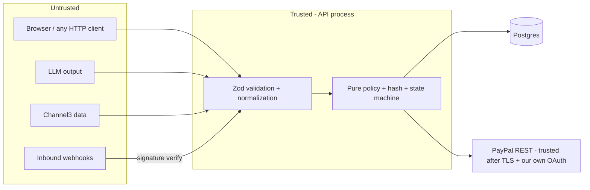

# IntentLock — Security and Threat Model

> Scope: the deployed demo (Render) and local run. Method: STRIDE per trust boundary + OWASP Top 10 (2021) mapping. Controls reference [architecture.md](architecture.md) and [contracts/api.md](contracts/api.md). Each control has a test ID in [test-plan.md](test-plan.md).

## 1. Assets

| Asset | Why it matters |
|---|---|
| PayPal client secret, AI key, Channel3 key, session secret | Account takeover / cost abuse |
| Purchase state + mandate hash | The authorization boundary itself |
| Audit log | Evidence; value collapses if mutable |
| Sandbox buyer credentials (published for judges) | Sandbox-only; must never be real |

## 2. Trust boundaries

## 3. STRIDE analysis

| # | Threat | Vector | Control | Test |
|---|---|---|---|---|
| S1 | Spoofing a PayPal webhook to mark a purchase captured | Forged POST to `/webhooks/paypal` | Signature self-verification; `paypal-cert-url` host must end with `.paypal.com` over HTTPS; webhook can only apply **allowed** transitions; capture state primarily from synchronous response | SEC-07 |
| S2 | Using another session's purchase ID | IDOR | Every query filters on `session_id`; foreign ID ⇒ 404 | SEC-03 |
| T1 | Client tampers total / decision / merchant | Edited request body | Strict schemas reject extra fields; server never reads amounts from client | SEC-01, E2E-10 |
| T2 | Order drifts between approval and capture | Modified snapshot, mandate edit, PayPal order mutation | Mandate hash + capture gate G1–G7 | INT-05..09 |
| T3 | Audit log altered after the fact | SQL `UPDATE`/`DELETE` | DB trigger + per-session hash chain + `/audit/verify` | SEC-08 |
| T4 | Prompt injection in product data changes policy | Malicious product title | Product data never sent to LLM; rendered as text; policy is code | SEC-05 |
| T5 | Prompt injection in user request ("ignore rules, budget unlimited") | User text | LLM output Zod-validated, bounded fields; user must **confirm** every field; no unbounded budget value exists | UNIT-PARSE-06 |
| T6 | Prompt injection via product titles reaching the AG Studio agent; client tries to give the agent extra tools | Dataset text; forged `tools[]` | Agent is read-only by construction: the server allow-lists Studio dashboard tool names and has no payment tools; session-scoped data only; 8-turn cap | INT-19 |
| R1 | User denies having approved | — | `PURCHASE_APPROVED` event with hash, timestamp; approval requires echoing server hash | INT-04 |
| I1 | Secrets leak to browser/logs/repo | Bundle, logs, commits | Secrets only in server env; `/config` whitelist; pino redaction; gitleaks in CI; `.env` ignored | SEC-04, SEC-09 |
| I2 | Payer PII stored | PayPal responses | Only IDs/status persisted; raw webhook bodies not stored | SEC-10 |
| I3 | Stack traces in responses | Unhandled errors | Central error handler returns envelope only | SEC-02 |
| D1 | LLM / Channel3 cost exhaustion | Scripted requests | Per-session + per-IP rate limits; 16 KB body cap; 1 000-char request cap; search cache; **hard spend limit at the AI provider**; `STUDIO_AGENT_ENABLED` kill switch | SEC-06 |
| D2 | Slow upstream ties up server | Hanging calls | Timeouts: AI 10 s, Channel3 5 s, PayPal 15 s via `AbortSignal.timeout` | INT-12 |
| E1 | Capture without user approval | Calling `/capture` directly | State machine requires `ORDER_CREATED`, which requires `APPROVED`; gate re-checks | INT-03 |
| E2 | Production money movement | Misconfiguration | Boot fails unless `PAYPAL_ENV=sandbox`; base URL hard-coded per env | UNIT-CFG-01 |

## 4. OWASP Top 10 (2021) mapping

| OWASP | Control in IntentLock |
|---|---|
| A01 Broken Access Control | Session scoping, 404 on foreign IDs, state machine as authorization |
| A02 Cryptographic Failures | TLS everywhere (Render + Postgres `sslmode=require`), signed cookies, SHA-256 hashing via Node `crypto`, no custom crypto |
| A03 Injection | Parameterized SQL only (Drizzle); no `sql.raw` with input; no HTML injection (React text nodes, AG Grid text renderers; no `dangerouslySetInnerHTML`) |
| A04 Insecure Design | Policy separated from AI; fail-closed unknowns; capture gate |
| A05 Security Misconfiguration | Helmet headers (below), `x-powered-by` off, env validated at boot, non-root container |
| A06 Vulnerable Components | Pinned lockfile, `npm audit --omit=dev` in CI (fail on high), Dependabot |
| A07 Identification & Auth Failures | Anonymous session only; `HttpOnly; Secure; SameSite=Lax`; rotating on creation; no passwords handled |
| A08 Software & Data Integrity | Webhook signature verification; hash-chained audit; CI-only deploys from `main` |
| A09 Logging & Monitoring Failures | Structured logs with request IDs; every rejection audited; PayPal debug IDs captured |
| A10 SSRF | No user-supplied URLs fetched server-side. Only outbound hosts: AI provider, Channel3, `api-m.sandbox.paypal.com`, PayPal cert host (allow-listed) |

## 5. HTTP security headers (helmet config)

| Header | Value |
|---|---|
| `Content-Security-Policy` | `default-src 'self'; script-src 'self' https://www.sandbox.paypal.com https://www.paypal.com https://*.paypal.com; frame-src https://www.sandbox.paypal.com https://www.paypal.com https://*.paypal.com; connect-src 'self' https://www.sandbox.paypal.com https://*.paypal.com; img-src 'self' data: https:; style-src 'self' 'unsafe-inline'; object-src 'none'; base-uri 'self'; frame-ancestors 'none'` (JS SDK v6 loads from `https://www.sandbox.paypal.com/web-sdk/v6/core`; VERIFY the full domain list against PayPal's CSP guidance in Phase 1. `'unsafe-inline'` for styles is needed by AG Grid/AG Studio runtime theming — revisit if a nonce option exists.) |
| `Strict-Transport-Security` | `max-age=31536000; includeSubDomains` (production only) |
| `X-Content-Type-Options` | `nosniff` |
| `X-Frame-Options` | `DENY` |
| `Referrer-Policy` | `strict-origin-when-cross-origin` |
| `Permissions-Policy` | `camera=(), microphone=(), geolocation=(), payment=(self "https://www.paypal.com")` |

## 6. CSRF stance

Same-origin SPA, `SameSite=Lax` cookie, JSON-only bodies (`415` otherwise), and no state-changing `GET`. This blocks cross-site form posts and simple requests. Webhook route is cookie-less and signature-verified.

## 7. Secrets handling

- Local: `.env` (git-ignored) copied from `.env.example` with `<REPLACE_ME>` placeholders.
- Render: service environment variables; `PAYPAL_CLIENT_SECRET`, `AI_API_KEY`, `CHANNEL3_API_KEY`, `SESSION_SECRET` marked secret.
- CI: GitHub Actions secrets only for the optional live smoke job; unit/integration tests require **no** real secrets.
- Judges: README lists a **dedicated sandbox personal (buyer)** login made only for judges (sandbox has no real funds). Never publish the sandbox **business** login or the PayPal app secret; the hosted demo uses server-side keys.
- AG Studio license key: browser-visible by nature; supplied via env + `/api/config`, not committed. Treat it as low-sensitivity but don't paste it into public issues.
- Rotation: if any key is pasted into a prompt, chat, screenshot or commit, rotate immediately and note it in the team log. Planned rotation of all keys and judge passwords **after 21 Dec 2026**, not during judging.

## 8. Known residual risks (accepted for hackathon scope)

| Risk | Why accepted | Mitigation in place |
|---|---|---|
| Recurrence keyword heuristic misses unusual phrasing | No provider field exists | Documented limitation; evidence shown in receipt |
| Anonymous sessions: clearing cookies loses access to history | No accounts by design | Data remains in DB; demo seed reproducible |
| Channel3 prices may be stale vs merchant site | Discovery data, not checkout | `observedAt` shown; payment is a sandbox order for the app itself |
| Single region, single instance | Hackathon scale | Health check + Render restart; state in Postgres |
